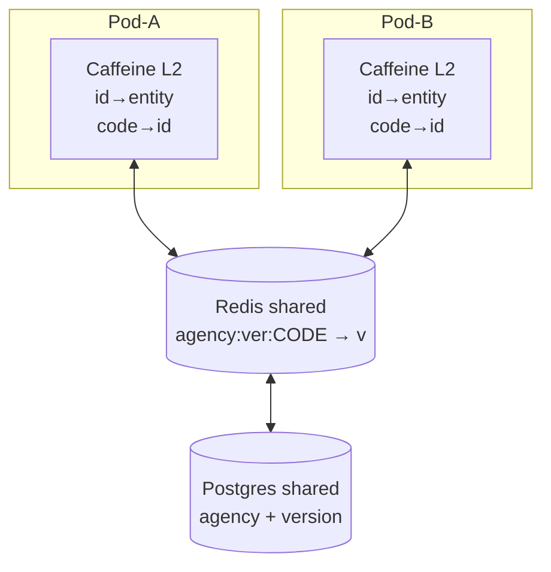
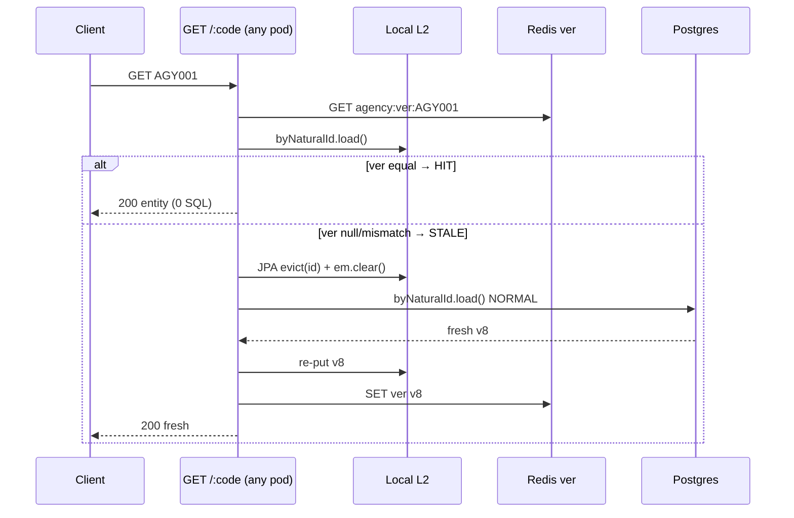
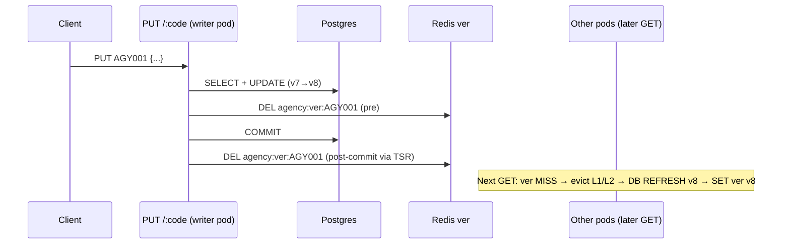

# Quarkus Agency Distributed Cache (Hibernate L2 + Redis Version Markers)

Near (local Caffeine L2) + far (shared Redis `@Version` markers) coherence for a multi-pod Quarkus app. Writes go straight to DB (bypass cache), then double-delete the Redis marker so other pods force DB refresh on next GET.

---

## 🎯 Architecture Summary

* **Framework:** Quarkus 3.15 + Gradle
* **ORM:** Hibernate ORM with Panache + L2 (Caffeine, per-pod) + `@NaturalId agencyCode`
* **Coherence:** Redis holds ONLY `agency:ver:CODE → @Version` (8 bytes, not DTOs) via `AgencyCacheService`
* **Reads:** `AgencyQueryRepository.byNaturalId` compares local version vs Redis marker; equal = L2 HIT (0 SQL), else JPA-evict + `em.clear()` + DB reload + re-warm both
* **Writes:** `AgencyRepository` DB-direct (bypass cache); `PUT/DELETE` double-delete marker (pre + post-commit via `TransactionSynchronizationRegistry`); `POST` warms marker post-commit
* **Fail-open:** Redis errors degrade to DB reads, never 500s

---

## 📂 Project Structure

```
quarkus-agency-cache/
├── build.gradle                                    # Gradle dependencies & Quarkus plugin
├── settings.gradle                                 # Project metadata
├── gradle.properties                               # Quarkus BOM & plugin versions
├── README.md                                       # Documentation & OpenShift manifests
├── src/
│   ├── main/
│   │   ├── java/com/example/
│   │   │   ├── dto/
│   │   │   │   ├── AgencyDto.java                  # Redis-serializable DTO
│   │   │   │   └── BulkQueryRequest.java           # Bulk lookup request payload
│   │   │   ├── entity/
│   │   │   │   └── Agency.java                     # @Cacheable READ_WRITE + @NaturalId + @Version (entity-only)
│   │   │   ├── repository/
│   │   │   │   ├── AgencyQueryRepository.java      # Reads: L2 + Redis version validation, evict+reload heal
│   │   │   │   └── AgencyRepository.java           # Writes: DB-direct (bypass cache for strong consistency)
│   │   │   ├── service/
│   │   │   │   └── AgencyCacheService.java         # Redis version markers get/put/evict (fail-open)
│   │   │   └── resource/
│   │   │       └── AgencyResource.java             # REST API separating queries and commands
│   │   └── resources/
│   │       └── application.properties              # Config for DB, Redis & TTL
│   └── test/
│       └── java/com/example/
│           └── AgencyCacheResourceTest.java        # Integration tests for all scenarios
```

---

## 🚀 Running the Project

### 1. Prerequisites
* Java 17 or higher
* Gradle (or use `gradle wrapper` to generate wrapper scripts)
* Docker or Podman (if using Quarkus Dev Services for automatic Redis & Postgres containers)

### 2. Start in Quarkus Dev Mode
```bash
gradle quarkusDev
```
*Quarkus Dev Services will automatically start a PostgreSQL and Redis container in the background if Docker/Podman is running.*

### 3. Run the Automated Tests
```bash
gradle test
```

The test suite in [`AgencyCacheResourceTest.java`](src/test/java/com/example/AgencyCacheResourceTest.java) is STALE (asserts old `agency:code:` DTO keys) and needs rewrite to `agency:ver:` Long markers. Current behavior to assert:
1. **Creation:** `POST` persists to DB, warms `agency:ver:CODE` post-commit.
2. **Read:** 1st `GET` = `COHERENCE MISS` + DB refresh + warm marker; 2nd `GET` = L2 `HIT` (0 SQL).
3. **Update:** `PUT` double-deletes marker; next `GET` on any pod = `STALE → refresh v+1`, then `HIT`.
4. **Batch Read:** per-code coherence check via `findByAgencyCodes`.
5. **Delete:** double-deletes marker; next `GET` = 404 + marker cleaned.

---

## 🧪 Manual API Testing (cURL)

### 1. Create a New Agency (Zero Redis calls)
```bash
curl -X POST http://localhost:8080/api/agencies \
  -H "Content-Type: application/json" \
  -d '{"agencyCode": "AGY001", "name": "Delta Travel", "email": "info@delta.com", "status": "ACTIVE"}'
```

### 2. Query Agency (near+far coherence)
```bash
curl http://localhost:8080/api/agencies/AGY001
```
1st = `COHERENCE MISS` + DB refresh, 2nd = L2 `HIT`.

### 3. Update Agency (double-deletes version marker)
```bash
curl -X PUT http://localhost:8080/api/agencies/AGY001 \
  -H "Content-Type: application/json" \
  -d '{"name": "Delta Global Travel", "email": "info@delta.com", "status": "ACTIVE"}'
```

### 4. Bulk Query (per-code coherence check)
```bash
curl -X POST http://localhost:8080/api/agencies/bulk \
  -H "Content-Type: application/json" \
  -d '{"agencyCodes": ["AGY001", "AGY002", "AGY003"]}'
```

---

## 🔀 Flow Diagrams (multi-pod coherence)

### Components


### Read path (GET /:code)


### Write path (PUT /:code)


**30-sec narration:**
1. Reads are near+far: local Caffeine L2 is fast, Redis holds only `version` per code as shared truth.
2. Every `GET` compares `local.version` vs `Redis.version`. Equal = serve L2, zero SQL. Else evict-by-id, clear L1, reload DB once, re-warm both.
3. Writes go straight to DB (bypass cache), then double-delete the Redis marker (inside Tx + post-commit). No data in Redis, 8 bytes per key.
4. Other pods heal lazily on next `GET` — one `STALE → refresh` log, then `HIT`. Fail-open: Redis down = every `GET` refreshes DB (slower, still correct).

> Multi-pod dev note: disable Dev Services and point both instances at ONE Postgres + ONE Redis, else each `quarkusDev` spawns isolated containers and updates stay invisible.

---

## ☸️ OpenShift Deployment Guide

In OpenShift, inject Redis connection details via environment variables:

```yaml
apiVersion: apps/v1
kind: Deployment
metadata:
  name: agency-service
  namespace: your-namespace
spec:
  replicas: 3
  selector:
    matchLabels:
      app: agency-service
  template:
    metadata:
      labels:
        app: agency-service
    spec:
      containers:
        - name: agency-service
          image: image-registry.openshift-image-registry.svc:5000/your-namespace/agency-service:latest
          env:
            - name: REDIS_HOST
              value: "redis-service.your-namespace.svc.cluster.local"
            - name: REDIS_PORT
              value: "6379"
            - name: DB_JDBC_URL
              value: "jdbc:postgresql://postgres-service.your-namespace.svc.cluster.local:5432/agencydb"
            - name: DB_USERNAME
              valueFrom:
                secretKeyRef:
                  name: db-secret
                  key: username
            - name: DB_PASSWORD
              valueFrom:
                secretKeyRef:
                  name: db-secret
                  key: password
          ports:
            - containerPort: 8080
          resources:
            limits:
              cpu: "1"
              memory: 512Mi
            requests:
              cpu: 200m
              memory: 256Mi
```
